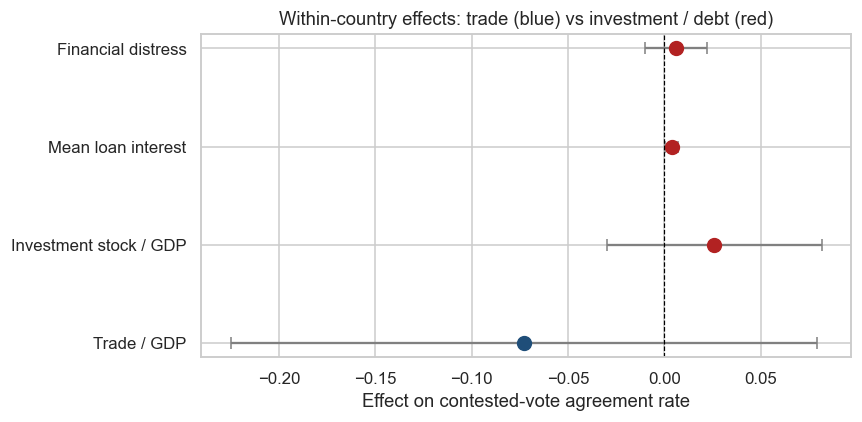

::: {.project-meta}
**Status:** Complete | **Course:** DACSS 611 (Introduction to Python) final project | **Methods:** two-way fixed effects (PanelOLS), clustered standard errors, nested likelihood-ratio tests | **Tools:** Python (pandas, linearmodels) | **Code:** available on request
:::

## Research question

**Does economic dependence on China predict how countries vote with China in the UN General Assembly, and if so, does *trade* or *investment/debt* better explain the effect?**

Two competing stories from IR theory make different predictions:

- **Liberal interdependence**: economic ties create mutual interest and institutional forms pull countries together, therefore, deeper *trade* with China should pull a country's voting closer to China's.
    + This also supports the idea of including measures on a countries specific regime type. I do so as controls, and for my own interest.
- **Patron-client / structural dependence**: Alignment can be bought. What I believe matters the most is *asymmetric* leverage, or large investment stocks, loans, and especially financial distress that gives China additional leverage. If this were true, investment from China will be the primary predictors.

The primary goal is to see which form of power actually moves voting alignment once we hold each country and each year fixed. Evidence for liberal interdependence would be a positive trade effect; evidence for structural dependence would be a positive investment effect with trade washing out.

## Data

The analysis joins five sources, each contributing one piece of the final tapestry:

| Source | Purpose | Unit of Analysis |
|---|---|---|
| **UNGA voting** (BSV, Harvard Dataverse) | Each country's vote on each resolution, which serves as the dependent variable | decision-country |
| **AidData GCDF v3.0** | Chinese development-finance projects (the BRI investment/financial distress measure) | project |
| **UN Comtrade** | Bilateral trade with China (imports/exports) | reporter-year |
| **V-Dem** | Democracy indices, used as controls | country-year |
| **World Bank** | GDP, for normalizing the economic measures | country-year |
| **COW NMC** | Population, used to build GDP per capita | country-year |

## Approach

All five sources were cleaned to a common country-year key (a name normalizer plus per-source crosswalks), aggregated to the country-year level, and left-joined onto the UN voting data with row-count checks at every merge. Agreement with China is measured overall and on contested votes, at both the state-year and the vote level. Models use two-way fixed effects (country and year) so that identification comes from within-country change, with standard errors clustered by country (and two-way by country and resolution in the vote-level models). Trade and investment blocks are added in a nested ladder on a frozen sample and compared with likelihood-ratio tests and AIC, then checked against country-specific time trends and log-dollar specifications.

{fig-alt="Coefficient plot comparing trade and investment effects on agreement with China"}

## Conclusion

**What the evidence says.** Descriptively, countries that receive Chinese investment vote with China far more often, and the gap is largest on exactly the contested votes where leverage should matter - a picture that looks quite a bit like structural dependence. But once each country and year is held fixed, that relationship largely disappears: within-country changes in either trade or investment dependence don't reliably move contested-vote agreement, and the nested-ladder and country-trend checks don't find a robust effect for either channel. Therefore, this design finds the China alignment gap to be mostly a *between-country* fact - about which countries are economically tied to China - rather than evidence that *deepening* ties pulls a country's votes into agreement over time. That doesn't cleanly confirm liberal interdependence or structural dependence; if anything it cautions that the cross-sectional correlation both theories would point to doesn't survive a demanding within-country test or are there other confounders that are driving agreement.

**Limits** The outcome is a contested-vote agreement *rate*, an imperfect proxy for true ideological distance. Trade missingness was filled with zeros, making dealing with missingness impossible. The investment stock is monotonic, which makes within-country identification difficult. With more time, the next steps would be a proper ideal-point outcome, an event-study designed around the timing of major loans, and a trade measure that separates true zeros from unreported years. Even then, I dont believe that there will be a profound relationship, but it would be interesting to investigate further.

