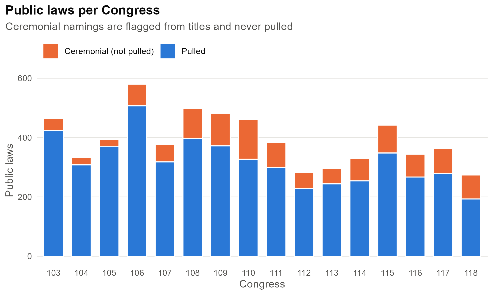

::: {.project-meta}
**Status:** In progress | **Course:** DACSS 758 (Text as Data) final project | **Methods:** Congress.gov API and GovInfo text pipeline, XML and regex parsing, dictionary measures of constraint, Poisson fixed-effects models, randomization inference | **Tools:** R (quanteda, congress) | **Code:** available on request
:::

## Research question

**Does Congress constrain the President less on national-security laws, and how does this change when paired with periods of divided government?** Most statutes give some power away from the legislature in the form of discretion to the executive; the real question is how much deference is given.

## Theory

**Delegation theory.** Legislatures write tighter, more detailed statutes when they distrust the agencies that will carry them out.[^ep] Huber and Shipan extend the argument and show that the *text* of statutes is where this control is often exercised.[^hs]

**The two presidencies.** Wildavsky argued that there are effectively two presidencies: one that gets its way on defense and foreign policy, and a much weaker one at home.[^wild] Later work finds that the foreign-policy advantage is real but smaller and more conditional than Wildavsky claimed.[^cw]

**Partisan checks on war powers.** Howell and Pevehouse show that Congress does constrain presidents on military matters, and that it does so mainly when the opposition party controls it.[^hp] That predicts the divided-government effect should be at least as strong in national-security law as anywhere else.

| | Hypothesis | Comes from |
|---|---|---|
| H1 | Laws passed under divided government contain more constraining language. | Delegation theory |
| H2 | National security laws contain less constraining language than domestic laws. | Two presidencies |
| H3 | The divided-government effect is smaller in national-security law. | Two presidencies; Partisan checks |

: Hypotheses {#tbl-hyp}

## Data

The corpus is **every public law enacted from the 103rd through the 118th Congress (1993 to 2025)**: 6,302 laws pulled from the Congress.gov API and GovInfo. After dropping ceremonial laws (e.g., post office naming) and a few others 4,684 laws remain, split into about 149,000 sections and appropriations accounts. Each unit is classified as national security or domestic, and each law is coded for if either house that passed said was the opposite party of the President.

{fig-alt="Bar chart of public laws per Congress, 103rd to 118th"}

## Findings

Final models are still being finalized and estimated. This will be updated soon. 

[^ep]: Epstein, David, and Sharyn O'Halloran. 1999. *Delegating Powers: A Transaction Cost Politics Approach to Policy Making under Separate Powers*. Cambridge University Press.

[^hs]: Huber, John D., and Charles R. Shipan. 2002. *Deliberate Discretion? The Institutional Foundations of Bureaucratic Autonomy*. Cambridge University Press.

[^wild]: Wildavsky, Aaron. 1966. "The Two Presidencies." *Trans-action* 4: 7-14. 

[^cw]: Canes-Wrone, Brandice, William G. Howell, and David E. Lewis. 2008. "Toward a Broader Understanding of Presidential Power: A Reevaluation of the Two Presidencies Thesis." *The Journal of Politics* 70 (1): 1-16.

[^hp]: Howell, William G., and Jon C. Pevehouse. 2007. *While Dangers Gather: Congressional Checks on Presidential War Powers*. Princeton University Press.
