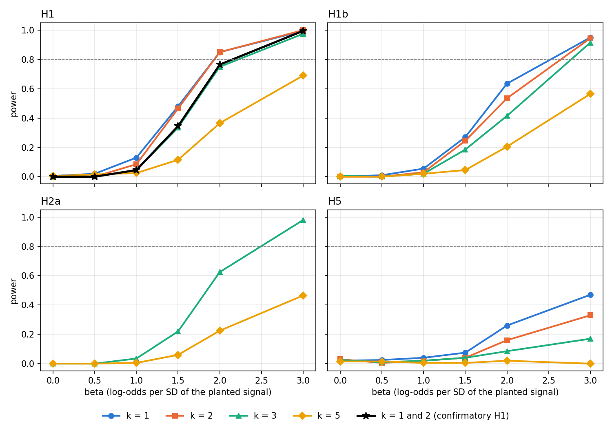

::: {.project-meta}
**Status:** In progress (data layer built; pre-registration being finalized) | **Course:** DACSS 756 (Machine Learning) final project | **Data:** V-Dem v16, Episodes of Regime Transformation (ERT) v16 | **Tools:** Python, R | **Code:** available on request
:::

## Overview

The project forecasts three things for the world's democracies:

- **Onset (stage 1):** will an autocratization episode start within *k* years?
- **Completion (stage 2):** for a democracy already inside an episode, will it break down within *k* years?
- **Severity:** how far will the Electoral Democracy Index (EDI) fall over an episode?

The framing is Robert Paxton's account of fascism as a process with warning signs.

The project is **hypothesis-driven and ML-first**.

- The substantive claim: leading warning signs (polarization, political violence, attacks on courts, weakened legislative constraints, party anti-pluralism) carry forecasting information *beyond* what the trajectory of democracy itself already tells you.
- The ML machinery that tests it:
  - a multi-model bake-off on two forecasting tasks;
  - a clean-vs-full feature audit for circularity;
  - drop-group refits;
  - a horizon-decay curve;
  - calibration;
  - a locked test set scored once.

**Model comparison is the robustness machinery.** A finding that holds across penalized regression, gradient boosting and a recurrent net is not an artifact of one algorithm. The fly connectome appears only as an optional exploratory reservoir row (section 6.4).

## Research questions

**RQ1.** Can V-Dem warning signs forecast the onset of autocratization in democracies, and how fast does that skill decay with horizon?

**RQ2.** Do Paxton's *leading* signs add forecasting information beyond the outcome's own trajectory, especially at long horizons, while the outcome's own components mainly add short-horizon "momentum"?

**RQ3.** Is breakdown predictable once an episode has begun, and do its drivers differ from the drivers of onset?

## Design

The study is pre-registered before any model is fit: the panel, labels, and audits are built and tested first, a power simulation on synthetic labels sets the minimum effects worth reporting, and the final comparison is scored once on a locked test set. Models are compared against a persistence baseline using Brier skill and precision-recall AUC, with country-clustered bootstrap intervals and drop-group refits to measure what each family of warning signs adds.

{fig-alt="Power curves from the pre-registration simulation"}

## Results

Models are still being finalized and estimated. The results will be public soon.

The project grew out of an earlier study in the same course, which tested a fly-connectome reservoir on conflict forecasting: see [Can a Fly Brain Forecast War?](fly-connectome.qmd).
